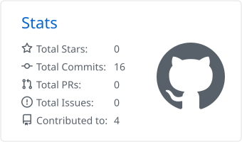
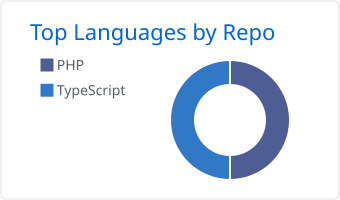

## Hi, I'm Nelson 👋
🙋🏿‍♂️ But people call me Júlio

Web developer in the making, based in Vila Nova de Gaia 🇵🇹, with a focus on **full-stack and back-end** development.

- 🎓 Finishing my CTeSP in Web and Mobile Development at ISLA Gaia, and starting a degree in **Computer Engineering**
- 🔭 Currently working on **[Athlytic](https://github.com/Nelson-Vital/Athlytic)**, a physical activity tracking platform built with PHP and MySQL
- 🌱 Building strong programming fundamentals across web (PHP, JavaScript, React) and mobile (Flutter)
- 🍽️ Coming from restaurant management, where I learned to lead teams, solve problems under pressure and keep things running

## Tech Stack

  

    
  

  

    
  

## Projects

| Project | What it is | Stack |
|---|---|---|
| [Athlytic](https://github.com/Nelson-Vital/Athlytic) | Physical activity tracking platform (final course project) | PHP, MySQL |
| [Da Estação](https://github.com/Nelson-Vital/Da-Esta-o) · [live](https://da-estacao.netlify.app) | Marketplace for local products from small and medium producers | React, TypeScript |

## GitHub Stats

  <picture>
    <source media="(prefers-color-scheme: dark)" srcset="./profile-summary-card-output/github_dark/3-stats.svg" />
    
  </picture>
  <picture>
    <source media="(prefers-color-scheme: dark)" srcset="./profile-summary-card-output/github_dark/1-repos-per-language.svg" />
    
  </picture>

